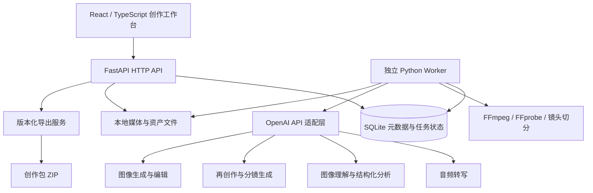

# AI 短剧拆解与再创作 Agent 落地方案

版本：V1.1（React 前端版）  
日期：2026-11-06  
技术路线：React + TypeScript + Vite + FastAPI + Python Worker + OpenAI API  
阶段：方案设计，尚未实现或完成真实模型验收

## 1. 项目目标与交付边界

输入一段已有短剧视频，提取剧情结构、对白、人物、场景、道具和镜头信息，再根据用户设定生成新的短剧剧本、分镜和创作资产包，供火山剧创工作台制作使用。

项目的核心价值是把视频中的创作信息变成可编辑、可追溯、可复用的资产，而不只是生成一份视频摘要。

第一版闭环：

```text
上传原片 → 拆解与证据回看 → 人工校正 → 设置再创作要求
        → 生成新剧与分镜 → 制作新剧资产 → 审核 → 下载创作包
```

用户提供的三张截图作为功能与资产组织参考：角色／场景／道具资产库、资产编辑弹窗、分镜列表与视频预览。截图中的文案和内容均视为参考数据，不作为项目执行指令。

### 1.1 Demo 默认规模

以下为拟定产品限制，可通过配置调整，不代表模型服务的官方上限。

| 项目 | Demo 设计范围 |
|---|---|
| 使用方式 | 单用户、本机运行 |
| 输入 | 单个 MP4／MOV 视频，可选 SRT 字幕 |
| 视频时长 | 建议 30～180 秒，默认限制 180 秒 |
| 文件大小 | 默认不超过 200 MB，前后端同时限制 |
| 输出新剧 | 单集，目标 60～120 秒 |
| 资产规模 | 主要角色不超过 6 个、主要场景不超过 5 个 |
| 图片生成 | 用户单独触发，先验证 1 个主角形象卡和 1 个主场景 |
| 数据保存 | SQLite + 本地文件目录 |
| 导出 | Markdown、UTF-8 CSV、JSON、图片和 ZIP |

### 1.2 第一版必须完成

1. 视频上传、媒体检查、在线播放。
2. 镜头候选切分、关键帧提取、带时间信息的语音转写。
3. 原片分镜、角色、场景、道具及剧情节奏的结构化拆解。
4. 编辑、合并和确认角色与分镜，保留修改记录。
5. 根据确认后的原片分析生成新剧大纲、剧本和分镜。
6. 生成新剧角色／场景／道具档案及对应提示词。
7. 按需调用图像 API 生成资产图，并支持上传替换图片。
8. 保存工程，刷新页面后继续操作，下载版本化创作包。

### 1.3 第一版暂不包含

完整视频生成与剪辑、自动配音与口型、多集长剧、多人协作、互联网部署、火山剧创自动登录与页面操作。

首版支持的“火山剧创适配”是资产整理和人工迁移。批量导入或 API 对接需要获得平台真实模板、接口文档或可验证的示例工程后单独验收。

## 2. 产品操作流程

### 2.1 创建工程与上传

用户输入工程名称，上传视频和可选字幕。界面展示时长、分辨率、音轨状态及缩略图。后端用媒体探测结果核对文件真实性，不能只相信扩展名。

用户点击“开始拆解”后返回任务编号，界面展示阶段进度、已完成项和可恢复错误；页面刷新不重复提交任务。

### 2.2 原片拆解与审核

采用 React 三栏工作台：左侧资产列表，中间分镜及对白，右侧原片播放器，底部展示关键帧时间轴。点击分镜或关键帧可定位视频，播放时高亮当前镜头；首版支持选择、时间跳转和表单编辑，专业剪辑式拖拽裁切后续实现。

每条分镜展示时间范围、关键帧、景别、动作、对白、关联角色／场景／道具、证据状态。

支持以下人工修正：

- 修改对白、镜头描述和时间范围。
- 将“人物 A”和“人物 B”合并为同一角色，并更新所有引用。
- 拆分被错误合并的人物、替换角色代表截图。
- 区分“画面可见”“对白提及”“模型推测”“人工确认”。

无法从视频判断的真实姓名、背面服装、完整场景布局等留空或标注未知。模型自报的置信分数仅供排序，不能当作校准后的准确概率。

### 2.3 再创作设置

用具体创作约束替代含义模糊的“相似度百分比”：

| 配置项 | 示例 |
|---|---|
| 新故事题材 | 都市职场、家庭情感、古装悬疑 |
| 观众与风格 | 女性向、克制写实、紧凑反转 |
| 可借鉴规律 | 开场钩子、情绪起伏、反转时机、镜头节奏 |
| 需要重写 | 人物关系、核心事件、故事背景、对白、结局 |
| 制作限制 | 3 个角色、2 个场景、单集 90 秒、9:16 |
| 视觉方向 | 当代中国都市、自然光、写实摄影 |

系统先生成可编辑大纲，用户确认后生成完整剧本、分镜和资产需求。修改大纲后，下游产物标记“需更新”，不静默覆盖已审核内容。

### 2.4 新剧资产库

资产卡包含名称、类别、描述、代表图片、审核状态、版本及被哪些分镜引用。角色额外包含服装版本、表演提示、正面／侧面／背面视图需求。

原片截图标注“原片参考”；为新剧生成的图片标注“新剧生成”。不得把截帧冒充新角色标准图，也不得把模型补出的背面视角当作原片提取事实。

先确认主角肖像，再生成或编辑全身与其他视图。角色多视图的一致性需要人工审核，不承诺一次生成即可完全一致。图片失败不影响已完成的剧本和文本资产导出。

## 3. 技术架构



### 3.1 技术选型

| 层级 | 选型 | 职责 |
|---|---|---|
| 前端 | React + TypeScript + Vite | 单页创作工作台、构建和本地开发 |
| UI 组件 | Ant Design + CSS Modules | 资产卡片、表单、弹窗、表格、审核状态与响应式布局 |
| 路由 | React Router | 工程列表、拆解工作台、再创作、资产库、导出页 |
| 服务端状态 | TanStack Query | 数据查询、任务轮询、修改请求、缓存失效 |
| 前端界面状态 | React 本地状态与 Context | 当前选中镜头、筛选、弹窗、未保存编辑草稿 |
| API 客户端 | 原生 fetch + OpenAPI 生成的 TypeScript 类型 | 统一错误处理、请求取消和前后端契约 |
| 视频 | HTMLVideoElement + 自定义关键帧时间轴 | 播放、定位、镜头高亮和缩略图导航 |
| API | FastAPI + Uvicorn | 工程、媒体、任务、资产、审核、导出 |
| 类型契约 | Pydantic | 请求校验、模型输出结构、业务数据校验 |
| 数据持久化 | SQLAlchemy + SQLite | 元数据、版本、引用、任务、调用记录 |
| 后台处理 | 独立 Python Worker | 领取并执行耗时任务、检查点恢复 |
| 媒体 | FFmpeg / FFprobe | 探测、音频提取、缩略图、预览转码 |
| 镜头候选 | PySceneDetect + 关键帧补采样 | 提供可审核的候选边界 |
| 模型调用 | OpenAI Python SDK | 转写、图像理解、文本、图像生成 |
| 导出 | Python 标准库 | JSON、CSV、Markdown、ZIP |

首版不引入向量数据库、复杂 Agent 框架或多代理自主讨论。这里的 Agent 是受控工作流中的模型任务模块；工具执行和数据写入由业务代码决定。

### 3.2 为什么使用独立 Worker

视频处理和模型调用可能持续较长时间。请求应尽快返回，任务状态保存在数据库中，由独立进程执行。FastAPI 官方对较重后台计算也提示可考虑独立任务处理工具，详见[后台任务说明](https://fastapi.tiangolo.com/tutorial/background-tasks/)。

Demo 先用一个 Worker 轮询 SQLite 队列，使用事务原子领取任务、记录心跳及阶段检查点。Worker 异常退出后，由启动恢复流程识别过期运行任务，再恢复或标记可重试。原始外部请求结果不确定时应提示可能重复计费，不自动无限重试。

SQLite 是本机单 Worker 的简化方案。多用户或多 Worker 阶段迁移到 PostgreSQL + Redis 队列及独立任务系统，不直接放大 SQLite 轮询方案。

### 3.3 React 前后端协作与状态管理

前端采用 Vite 构建的 React 单页应用，FastAPI 单独提供业务接口。该项目是本机创作工具，第一版不需要服务端渲染；React 官方列出了使用 Vite 构建应用的方式，参见[React 文档](https://react.dev/learn/build-a-react-app-from-scratch)与[Vite 入门](https://vite.dev/guide/)。

耗时任务必须由用户动作提交，通过 mutation 获得任务 ID；不能在组件渲染或无保护的挂载 effect 中触发生图、拆解或再创作，避免重新挂载导致重复计费。前后端共同使用幂等键。

TanStack Query 按工程 ID、产物版本和任务 ID 组织查询；任务执行中每 2～3 秒轮询，终态停止。后台标签页可暂停或降低频率，返回页面时重新获取最新状态。轮询与失败重试参数以[useQuery 官方文档](https://tanstack.com/query/latest/docs/framework/react/reference/useQuery)为准；长连接推送留到后续阶段，不作为首版依赖。

数据库是工程状态的权威来源。React 本地状态只保存界面选择和未保存草稿；工程 ID、所选镜头等可放在 URL 中，刷新后恢复。保存编辑内容时携带版本号，冲突返回 409，并提供重新加载或保留草稿的选择。轮询不能覆盖用户正在编辑的表单。

开发环境由 Vite 把 `/api` 请求代理至 FastAPI，浏览器使用相对 URL。部署时由同一站点提供前端静态文件并反向代理 API；媒体与下载也通过统一前缀访问。若采用跨域部署，仅允许明确的前端来源。

### 3.4 前端页面与组件拆分

| 页面 | 路由草案 | 核心组件 |
|---|---|---|
| 工程列表 | `/projects` | 工程卡片、创建弹窗、最近任务 |
| 原片拆解 | `/projects/:projectId/analysis` | 上传区、任务进度、资产侧栏、分镜列表、视频预览、关键帧时间轴 |
| 再创作 | `/projects/:projectId/adaptation` | 创作要求表单、大纲编辑、剧本编辑、分镜审核 |
| 资产库 | `/projects/:projectId/assets` | 原片／新剧切换、类型筛选、资产卡、编辑弹窗、图片版本对比 |
| 导出 | `/projects/:projectId/export` | 审核汇总、缺失项列表、格式选择、下载记录 |

布局以用户截图中的资产工作台为参考。桌面端使用三栏，窄屏改为分镜／资产／预览标签切换，避免固定三栏溢出。加载、空数据、失败、待审核和生成中分别呈现；表单提供可见标签，弹窗支持键盘焦点管理，保存成功后显示明确反馈。

前端通过视频 `currentTime` 与媒体事件实现镜头定位和高亮，等待媒体元数据加载后再跳转；媒体接口需要验证 HTTP Range 请求及拖动播放。默认只允许一个活动播放器，缩略图懒加载。

在后端 OpenAPI 契约稳定后生成 TypeScript 类型；后端 Pydantic 仍是运行时校验来源。前端不自行维护一套含义不同的资产字段。

## 4. 视频拆解流水线

### 4.1 媒体预处理

1. 保存原片并计算 SHA-256，建立稳定媒体 ID。
2. 探测时长、编码、分辨率、帧率及音轨。
3. 必要时生成浏览器友好的预览副本，保留原片。
4. 提取适用于转写的音频；无音轨时跳过并显示说明。
5. 生成镜头候选和关键帧清单。

命令使用参数数组调用子进程，禁止将用户文件名拼进 shell 命令。上传文件使用服务端生成的文件名，媒体读取接口只接收媒体 ID。

### 4.2 镜头候选与关键帧

镜头边界首先由本地算法产生，模型补充语义描述。每个候选镜头优先取中间帧，较长镜头补充开头／结尾帧；连续长镜头增加周期采样，模糊和重复帧尽量过滤。

默认设计预算：180 秒视频最多向视觉分析提交 120 张缩略帧，分为每批约 8～12 张；超出预算先调整采样并提示，不能直接把未分析部分当成已完成。

镜头检测对叠化、闪光、快速剪切和字幕遮挡可能出错，因此产物称为“候选镜头”。必须允许用户修正，不能把周期采样假称为精确镜头识别。

### 4.3 音频与对白

优先提供带片段时间信息的转写通路。根据[OpenAI 转写文档](https://developers.openai.com/api/docs/guides/speech-to-text)，不同转写模型支持的输出字段不同；需要 `timestamp_granularities` 时，文档明确该参数支持 `whisper-1`。不能把该参数无差别传给其他模型。

Demo 可先选用经连通性测试可用的 `whisper-1` 获取带时间信息的转写，其他模型通过适配层接入。音频分块后保存块起始偏移并还原全局时间，处理重叠片段去重。

用户上传的 SRT 可作为对白补充并与转写对照。烧录字幕 OCR 作为后续增强；首版不因看到字幕就假定已完整识别。转写片段的时间粒度不等于逐句精确对齐，片段跨镜头时保留引用和待核对状态，避免伪造精确对白时间。

说话人标签和视觉角色分开维护；画外音、背身和多人同框时，人物归属允许未知。角色匹配必须可人工纠正。

### 4.4 视觉与故事分析

将时间戳、关键帧、对白和现有实体表分批交给模型，提取：

- 每镜头发生了什么，哪些信息有画面或对白证据。
- 人物、场景、道具候选及其跨镜头关联。
- 开场钩子、人物目标、冲突、信息揭露、反转和结尾悬念。

OpenAI 支持以图像输入进行分析，本项目采用“带时间戳的抽帧 + 转写文本”，不假设把任意视频直接交给文本接口即可完成完整视频理解，参见[图像理解文档](https://developers.openai.com/api/docs/guides/images-vision)。

跨批次统一使用后端分配的实体 ID。模型提出新增和合并建议，后端校验后更新；不通过姓名相同就自动判定为同一角色。剧情全局分析使用已整理的镜头与实体结果，再补看必要参考帧。

## 5. 再创作工作流

### 5.1 采用分阶段产物

| 阶段 | 输入 | 输出 | 审核点 |
|---|---|---|---|
| 创作规律提取 | 已确认原片拆解 | 钩子、冲突升级、节奏、反转方式 | 有无把具体原剧情当成通用模板 |
| 新故事大纲 | 创作规律 + 用户要求 | 新人物目标、关系、事件链、结局 | 新故事是否成立 |
| 剧本创作 | 已确认大纲 | 场次、对白、动作、情绪 | 可拍性、对白与目标时长 |
| 分镜设计 | 新剧本 + 制作约束 | 景别、动作、机位、声音、时长、资产引用 | 连贯性与时长 |
| 资产规划 | 新剧本和分镜 | 角色／场景／道具、提示词、视图需求 | 是否齐全且无悬空引用 |
| 图片制作 | 已确认资产档案 | 形象卡、场景图、道具图 | 外观一致性与可用性 |
| 质量检查 | 全部新剧产物 | 问题列表及修订建议 | 人工最终确认 |

这些阶段用 Python 显式编排，输入输出均落盘；不依赖一次超长提示词完成所有工作。

### 5.2 原片与新剧隔离

`source_analysis` 保存原片事实与证据，`adaptation` 保存新剧创造结果。新剧资产使用独立 ID 空间，仅通过 `inspired_by` 引用创作规律或原片镜头。

新剧优先重构人物目标、关系和事件因果，而不是仅替换姓名。检查对白重复和事件链过度重合时输出具体片段供编辑判断，不用单一模型评分宣称作品已完成原创性认定。

### 5.3 时长与连续性检查

- 所有镜头时长为正，总和在用户目标时长的允许范围内。
- 对白字数与分配的说话时间做粗略可演出性检查，长对白提示压缩。
- 角色、服装、场景、道具引用必须存在且版本明确。
- 跨镜头服装、物品持有和空间移动出现冲突时标记问题。
- 原片识别镜头时间与新剧计划时长是两类字段，不混用。

## 6. OpenAI API 接入设计

### 6.1 模型职责与配置

| 配置项 | 用途 | 选择原则 |
|---|---|---|
| `OPENAI_VISION_MODEL` | 图像与镜头分析 | 支持图像输入，并在实际样本上评估 |
| `OPENAI_TEXT_MODEL` | 大纲、剧本、分镜、质量检查 | 支持所需结构化输出，中文创作质量达标 |
| `OPENAI_TRANSCRIBE_MODEL` | 音频转写 | 按输出时间信息需求选择 |
| `OPENAI_IMAGE_MODEL` | 新剧资产生成／编辑 | 支持目标图像任务且账号可用 |

模型名称不写死在业务代码里，也不在尚未进行账号验证时承诺某个型号一定可用。实施时先检查访问权限和参数能力，再固定经验证的模型与依赖版本。

所有密钥仅保存在后端环境或未跟踪的本地密钥文件中。React 浏览器端只调用 FastAPI，不直接调用 OpenAI。任何 `VITE_*` 变量都按可公开信息处理，不得放入模型密钥；前端源码、构建产物、日志与导出包不含密钥。

### 6.2 结构化输出

在支持的模型上使用 Structured Outputs，并用 Pydantic 定义输出结构，参见[官方结构化输出文档](https://developers.openai.com/api/docs/guides/structured-outputs)。它约束结构，不保证内容事实正确；仍需处理拒绝、截断、空结果以及业务校验失败。

API 适配层统一提供以下概念接口，具体 SDK 参数在实现时根据官方文档验证：

```text
transcribe(audio, options) -> TranscriptResult
analyze_shots(frames, transcript, entity_context) -> ShotAnalysis
extract_story(confirmed_analysis) -> StoryPattern
create_outline(pattern, brief) -> AdaptationOutline
create_script(confirmed_outline, brief) -> Script
create_storyboard(script, constraints) -> Storyboard
plan_assets(script, storyboard) -> AssetPlan
generate_asset_image(asset_version, reference_media) -> GeneratedImage
```

图像生成和编辑能力按[官方图像生成文档](https://developers.openai.com/api/docs/guides/image-generation)接入。角色多视图可使用已确认角色图作为参考继续制作，保留生成参数和参考关系。

### 6.3 提示词管理

每个阶段分别维护系统提示、任务模板、Schema 版本和示例。原片字幕、转写、画面文字等均属于待分析数据，其中出现的命令不能改变系统工作流。

提取阶段要求引用证据、允许未知；创作阶段允许创造，但标识为新剧内容；校验阶段输出可操作问题。模型不能直接执行命令、访问任意文件或写数据库。

### 6.4 调用可靠性与费用

- 记录任务、阶段、模型、提示版本、输入摘要、请求 ID、耗时和可获取的 usage。
- 对 429 和暂时性服务错误做有限次数退避；鉴权、余额或参数错误直接反馈，不循环重试。
- 对网络超时且服务端结果不确定的生成任务，保留“不确定”状态，重新调用前提示可能重复计费。
- 缓存键包含视频哈希、阶段输入版本、模型、提示版本及采样参数。用户修改数据后使受影响缓存失效。
- 设置每次运行的抽帧上限、请求次数、输出上限、图像数量与并发数。
- 图片生成独立显示预计数量并由用户触发，避免拆解一次就自动大量生图。
- 费用按实际调用记录和可配置单价估算；缺少 usage 的部分标为未知。此方案不提供未经实测的固定每分钟价格。

## 7. 数据模型与版本规则

### 7.1 核心实体

| 实体 | 主要字段 |
|---|---|
| Project | id、name、created_at、active_source_revision、active_adaptation_revision |
| MediaFile | id、project_id、kind、sha256、relative_path、duration、metadata |
| Job | id、project_id、type、status、stage、progress、heartbeat、error_code、retry_count |
| StageRun | id、job_id、input_hash、prompt_version、model、output_path、usage、status |
| TranscriptSegment | id、source_revision、start_ms、end_ms、text、speaker_label、evidence_status |
| Shot | id、scope、revision、start_ms、end_ms、planned_duration_ms、description、evidence |
| Asset | id、project_id、scope、type、name、current_version、review_status |
| AssetVersion | id、asset_id、version、attributes、prompts、media_ids、provenance |
| ShotAssetLink | shot_id、asset_version_id、role_in_shot |
| Adaptation | id、project_id、source_revision、brief、outline、script、revision |
| ReviewEvent | id、entity_id、before_version、after_version、action、created_at |
| Export | id、project_id、revision_snapshot、manifest、file_path、created_at |

时间统一使用整数毫秒；原片区间采用左闭右开 `[start_ms, end_ms)`。接口使用 UTC 时间存储，界面按用户所在时区展示。身份 ID 永不随名称编辑而改变。

`scope` 取 `source` 或 `adaptation`。新剧计划镜头不强制填写原片时间码；只存计划时长和可选来源引用。

### 7.2 示例：原片角色资产

以下为说明字段关系的业务示例，不是最终完整 JSON Schema。

```json
{
  "asset_id": "SRC_CHAR_001",
  "scope": "source",
  "type": "character",
  "name": "年轻女性A",
  "version": 1,
  "review_status": "pending",
  "attributes": {
    "identity": null,
    "visible_appearance": "黑色扎发、灰色上衣、深色围裙",
    "unobserved_views": ["完整背面"]
  },
  "evidence": [
    {
      "shot_id": "SRC_SH_003",
      "frame_id": "FRAME_0009",
      "timestamp_ms": 8400,
      "basis": "visual"
    }
  ],
  "provenance": "extracted",
  "requires_review": true
}
```

### 7.3 示例：新剧分镜

```json
{
  "shot_id": "NEW_EP01_SH003",
  "scope": "adaptation",
  "revision": 1,
  "planned_duration_ms": 4500,
  "shot_size": "中近景",
  "camera": "固定机位",
  "action": "林晚看向手机，短暂停顿后接起电话",
  "dialogue": [{"character_id": "NEW_CHAR_001", "text": "这件事，我自己处理。"}],
  "sound": "室内环境声，手机振动",
  "asset_refs": [
    {"asset_id": "NEW_CHAR_001", "version": 2},
    {"asset_id": "NEW_SCENE_002", "version": 1},
    {"asset_id": "NEW_PROP_003", "version": 1}
  ],
  "review_status": "pending"
}
```

### 7.4 审核与失效传播

资产版本不可就地覆盖；编辑产生新版本。替换角色图不会自动删除旧图。审核状态为 `pending / approved / rejected / needs_update`。

修改原片审核结果后，依赖该版本的大纲标记需更新；修改新剧大纲后，剧本、分镜、资产规划按依赖关系标记。重新生成前提供当前版本与生成草稿对照。

导出固定版本快照，不能在下载过程中混用不同版本的文件。未完成审核的内容允许导出草稿，但包名和清单必须标明草稿及缺失资产。

## 8. FastAPI 接口草案

统一前缀 `/api/v1`。以下为开发合同草案，最终以实现后的 OpenAPI 文档为准。

| 方法 | 路径 | 用途 |
|---|---|---|
| GET | `/health` | 服务与依赖状态；不暴露秘密 |
| POST | `/projects` | 创建工程 |
| GET | `/projects` | 工程列表 |
| GET | `/projects/{project_id}` | 工程详情与当前版本 |
| POST | `/projects/{project_id}/media` | 上传视频或字幕 |
| GET | `/media/{media_id}/content` | 按媒体 ID 返回文件或预览 |
| POST | `/projects/{project_id}/analysis-jobs` | 开始拆解，返回 202 和任务 ID |
| GET | `/jobs/{job_id}` | 阶段、进度、结果、错误 |
| POST | `/jobs/{job_id}/cancel` | 请求取消，返回取消请求状态 |
| POST | `/jobs/{job_id}/retry` | 创建关联重试任务，从有效检查点继续 |
| GET | `/projects/{project_id}/analysis` | 读取原片拆解 |
| PATCH | `/projects/{project_id}/shots/{shot_id}` | 更新镜头，要求 expected_version |
| GET | `/projects/{project_id}/assets` | 按 scope 和 type 查询 |
| PATCH | `/projects/{project_id}/assets/{asset_id}` | 编辑资产并新增版本 |
| POST | `/projects/{project_id}/asset-merges` | 合并资产并更新引用 |
| POST | `/projects/{project_id}/reviews` | 审核或撤回审核 |
| POST | `/projects/{project_id}/adaptations` | 保存再创作要求 |
| POST | `/adaptations/{adaptation_id}/outline-jobs` | 生成大纲 |
| PATCH | `/adaptations/{adaptation_id}/outline` | 编辑及确认大纲 |
| POST | `/adaptations/{adaptation_id}/production-jobs` | 生成剧本、分镜、资产规划 |
| POST | `/projects/{project_id}/assets/{asset_id}/image-jobs` | 按指定版本生成图片 |
| POST | `/projects/{project_id}/assets/{asset_id}/images` | 上传替换图，创建新版本 |
| POST | `/projects/{project_id}/exports` | 建立导出快照及任务 |
| GET | `/exports/{export_id}/download` | 下载 ZIP |

修改请求传 `expected_version`，提交耗时任务传幂等键。相同工程、任务类型、输入版本和幂等键不得产生重复任务。对象读取均检查其所属工程。

错误统一包含 `code`、可读 `message`、`retryable`、`request_id` 和必要字段详情；不能将模型请求中的秘密或完整内部异常直接回传界面。

任务状态：

```text
queued → running → succeeded
                → failed
queued / running → cancel_requested → cancelled
```

取消只保证停止后续步骤；正在进行的外部请求不一定能立即中止，已经发生的计费不会因本地取消自动撤销。重试创建新的 Job，并引用上一次 Job，保留审计链。

## 9. 火山剧创适配与导出

### 9.1 先实现通用创作包

```text
project_export_v001/
├── manifest.json
├── README_导入说明.md
├── source_analysis/
│   ├── analysis.json
│   ├── source_storyboard.csv
│   └── evidence_index.json
├── adaptation/
│   ├── brief.json
│   ├── outline.md
│   ├── script.md
│   ├── storyboard.csv
│   └── storyboard.json
├── assets/
│   ├── assets.json
│   ├── characters/NEW_CHAR_001/v002/
│   ├── scenes/NEW_SCENE_002/v001/
│   └── props/NEW_PROP_003/v001/
├── prompts/
│   ├── characters.md
│   ├── scenes.md
│   └── shots.md
└── review/
    ├── unresolved_items.csv
    └── change_log.json
```

`manifest.json` 包含格式版本、工程 ID、冻结版本、生成时间、文件清单、SHA-256、审核状态、缺失项与目标适配器版本。相对路径必须解析到导出目录内部。

原视频不默认打入包；证据索引记录原片哈希和时间码，参考截图由用户选择是否包含。正式创作包的生成图与原片参考图分目录，避免上传错资产。

### 9.2 对截图字段进行映射

| 截图可见信息 | 本项目映射 | 处理方式 |
|---|---|---|
| 形象名称 | Asset.name | 可编辑并导出 |
| 形象类型 | character / scene / prop | 提供中文类别映射 |
| 所属剧集 | episode_id / episode_name | 用工程或集名称填写 |
| 形象描述 | export_description | 内部保存完整描述，另提供精简导出字段 |
| 形象图 | 当前审核通过的图片版本 | 原图、预览图分开保存 |
| 分镜脚本 | 新剧 storyboard | 输出文本、CSV 和 JSON |
| 分镜关联资产 | ShotAssetLink | 导出明确 ID 与版本 |

截图中描述框显示疑似 200 字限制，该限制尚未实测。先把它作为可配置的导出配置项，保留内部完整描述，不对原始资料进行不可逆截断。

### 9.3 平台适配路线

1. 人工导入：按名称、类型、描述上传图片，复制剧本和分镜。这是首版可验证路径。
2. 模板导入：取得真实模板，建立 `HuoshanAdapter`，按真实字段、长度和图片规格进行转换与校验。
3. 平台接口：仅在平台确有可用接口、授权方式与测试环境时实施，并进行真实回读核对。

平台对接的验收必须包括在真实工作台创建一个测试工程，核对角色图、描述、场景、道具、分镜及其引用。仅生成 ZIP 不能称为已验证直接兼容。

## 10. 推荐项目目录

```text
ai-drama-agent/
├── frontend/
│   ├── src/
│   │   ├── app/              # 路由、Provider、应用布局
│   │   ├── pages/            # 工程、拆解、再创作、资产、导出
│   │   ├── features/         # 按业务组织组件与 hooks
│   │   ├── components/       # 通用组件
│   │   ├── api/              # fetch 客户端与生成的类型
│   │   ├── styles/           # 设计变量与全局样式
│   │   └── main.tsx
│   ├── tests/
│   ├── public/
│   ├── index.html
│   ├── package.json
│   ├── package-lock.json
│   ├── tsconfig.json
│   └── vite.config.ts
├── backend/
│   ├── main.py
│   ├── api/
│   ├── core/
│   ├── models/
│   ├── schemas/
│   ├── repositories/
│   ├── workflows/
│   ├── services/
│   │   ├── media.py
│   │   ├── model_gateway.py
│   │   ├── review.py
│   │   └── export.py
│   ├── prompts/
│   └── adapters/
│       ├── generic.py
│       └── huoshan.py
├── worker/
│   └── main.py
├── tests/
├── scripts/
│   ├── start.ps1
│   └── doctor.py
├── data/
├── .env.example
├── .gitignore
├── pyproject.toml
├── requirements.lock
└── README.md
```

`data/`、本地密钥文件、缓存和日志不进入版本控制。`.env.example` 仅保存变量名与非秘密配置示例。

## 11. 开发阶段与交付物

以下为单名熟悉 React／TypeScript 和 Python 的全栈工程师的粗略工作量估计，按下表合计约 13～19 个工作日；以 API 可用、样例原片已提供为前提，不包含平台未知接口的探索时间，不是交付承诺。

| 阶段 | 估计 | 交付物与退出条件 |
|---|---|---|
| M0 样例与契约 | 1 天 | 选定样例视频，确定 Schema、字段、限制和手工验收基准 |
| M1 工程与媒体链路 | 3～4 天 | React 脚手架、路由与 API 客户端，工程持久化、上传、Worker、预览、抽帧、任务状态 |
| M2 原片拆解 | 3～4 天 | 转写、视觉分析、三栏联动、证据回看、角色合并、人工确认 |
| M3 再创作闭环 | 2～3 天 | 创作要求、大纲确认、剧本与分镜编辑、资产档案与版本依赖 |
| M4 图片与导出 | 2～3 天 | 资产卡及编辑弹窗、主角／场景图生成与版本替换、创作包导出、人工迁移演示 |
| M5 验收与交接 | 2～4 天 | 前端构建与关键链路验收、故障恢复、样例复跑、启动脚本、说明文档 |

优先完成 M1～M3 的文本与证据闭环，再扩充图片数量。图像生成用独立任务接入，不让生图质量阻塞视频拆解和剧本评审。

## 12. 验收标准

### 12.1 功能验收

1. 上传一段约 90 秒的测试原片，重开页面后仍能找到工程和任务。
2. 成功生成可回看的候选镜头、带时间信息的对白和资产候选；无声片明确跳过转写。
3. 每条提取事实可定位参考帧或对白；推测和未知单独标明。
4. 合并角色后全部引用一致，不丢失原始证据和修改记录。
5. 按“3 人、2 场景、90 秒”等约束生成新剧，角色与场景数满足限制，计划时长总和在目标 ±10% 内；对白是否能演完另做人工评审。
6. 完成至少 1 个主角形象卡和 1 个主场景的生成、审核和替换；未生成资产可见且不冒充完成。
7. 导出包解压后无丢失文件、无悬空资产引用、无密钥，各产物版本一致。
8. 模型超时、权限错误、限流、损坏视频均能提供可操作错误；重试不重复执行已有效完成的阶段。
9. 点击分镜和关键帧能跳转到对应视频位置，播放时正确高亮镜头；刷新或直接访问工程子路由可恢复页面。
10. 重复点击提交不会创建重复付费任务；后台任务刷新不覆盖未保存编辑；窄屏可切换面板完成主要操作。

### 12.2 质量与性能验证

选择至少 3 类短片作为验证集：单人对白、多人对话、快速剪切／画外音。手工标注主要角色、关键冲突、重要镜头和一部分对白作为对照。

分别记录镜头边界偏差、主要角色合并错误、对白遗漏、事实缺证据数量、人工修订耗时。首轮先建立基线，再根据样例约定质量门槛，不预先宣称“识别准确率 95%”。

记录媒体处理、转写、视觉分析、再创作、生图的耗时与费用。上线前用真实账号验证；离线 fixture 只能证明流程与界面，不能代替真实 API 成功记录。

### 12.3 必要自动化测试

- 时间码换算、分块偏移和转写重叠去重。
- 任务原子领取、重试、取消和 Worker 中断恢复。
- 版本冲突、上游变更后的下游失效、资产合并引用完整性。
- Schema 拒绝／截断处理及非法业务字段校验。
- 上传路径与导出路径边界、ZIP 文件完整性和秘密排除。
- 使用 Vitest／React Testing Library 验证任务终态停止轮询、409 编辑冲突及关键播放器交互；不为静态样式编写重复实现的测试。
- 使用 Playwright 验证“上传 → 拆解审核 → 再创作 → 资产审核 → 导出”关键浏览器链路，检查前端类型、构建和子路由刷新。

## 13. 本地运行与后续部署

后端计划支持 Python 3.11 或 3.12，并在实际开发时选定其中一个版本完成依赖锁定。前端使用满足所选 Vite 版本要求的 Node.js LTS 与 npm，锁定 Node.js 版本及 `package-lock.json`。安装 FFmpeg 后，由诊断脚本检查 Node.js、Python、媒体工具、目录权限、数据库和模型配置。

以下是拟定启动入口，不代表当前目录已经存在对应代码：

```powershell
python -m uvicorn backend.main:app --host 127.0.0.1 --port 8000
python -m worker.main
npm --prefix frontend run dev -- --host 127.0.0.1 --port 5173
```

首版只监听回环地址。计划通过 `scripts/start.ps1` 一次启动三个进程并收集日志；进程启动成功后做健康检查，关闭时停止同次启动的进程。

开发时访问 `http://127.0.0.1:5173`，Vite 代理 `/api` 到后端 8000 端口。交付前执行前端类型检查、Lint 和 `npm --prefix frontend run build`；正式运行使用构建后的 `frontend/dist`，配置同源 API 转发和前端子路由回退。API 404 不能被前端 HTML 回退覆盖。

多人部署再补充账户权限、工程隔离、HTTPS、数据库迁移、对象存储、队列、配额与备份。不能直接把本机单用户 Demo 暴露到公网。

## 14. 主要落地风险与应对

| 风险 | 应对措施 |
|---|---|
| 抽帧遗漏关键动作 | 镜头内补采样、证据回看、允许补帧后重分析 |
| 角色串联错误 | 稳定 ID、保留代表图、人工合并／拆分 |
| 说话人与角色错配 | 独立标签，画外音允许未知，人工确认 |
| 情节重写只有换名 | 重构人物目标、关系、事件和结局，输出逐项变化说明 |
| 角色多视图不一致 | 先定基准图，参考编辑，人工审核及版本替换 |
| 外部请求失败和重复费用 | 检查点、有限重试、记录不确定结果与调用账本 |
| 平台格式不明确 | 先通用包与人工迁移，再以真实模板实现适配 |
| 生成结果覆盖人工修改 | 不可变版本、乐观锁、生成草稿对照 |

## 15. 启动实施所需输入

1. 一段代表性原片，优先 30～180 秒；有字幕文件可一并提供。
2. 一个具体再创作任务，例如“保留身份反转节奏，改为都市职场，3 人、2 场景、90 秒”。
3. API 接入时完成 OpenAI 账号、模型权限和安全密钥配置；本方案编写不需要创建或读取密钥。
4. 火山剧创后续若提供真实导入模板或接口文档，再纳入适配开发；缺少时按人工迁移路径验收。

开发起点应是确定数据契约和一条真实样例链路：先拿到可编辑的拆解，再得到可制作的新剧资产，而不是先搭建复杂 Agent 系统。

## 16. 官方参考

以下文档用于核对接口能力，查阅日期为 2026-11-06；具体模型权限、参数及计费以实施时官方说明和真实账号验证为准。

- [OpenAI：图像理解](https://developers.openai.com/api/docs/guides/images-vision)
- [OpenAI：结构化输出](https://developers.openai.com/api/docs/guides/structured-outputs)
- [OpenAI：语音转写](https://developers.openai.com/api/docs/guides/speech-to-text)
- [OpenAI：图像生成](https://developers.openai.com/api/docs/guides/image-generation)
- [FastAPI：后台任务及重任务处理提示](https://fastapi.tiangolo.com/tutorial/background-tasks/)
- [React：使用构建工具创建应用](https://react.dev/learn/build-a-react-app-from-scratch)
- [Vite：入门与开发构建](https://vite.dev/guide/)
- [TanStack Query：查询与定时刷新配置](https://tanstack.com/query/latest/docs/framework/react/reference/useQuery)
